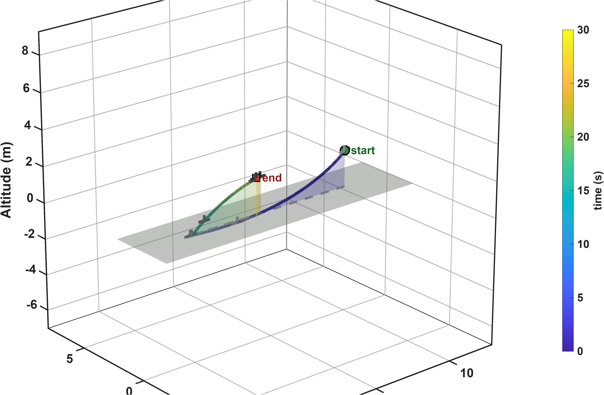
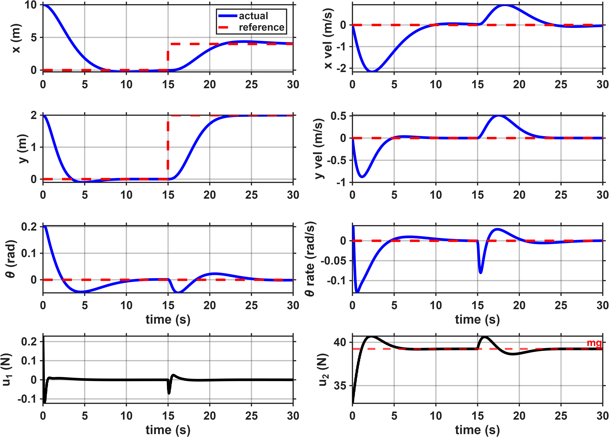
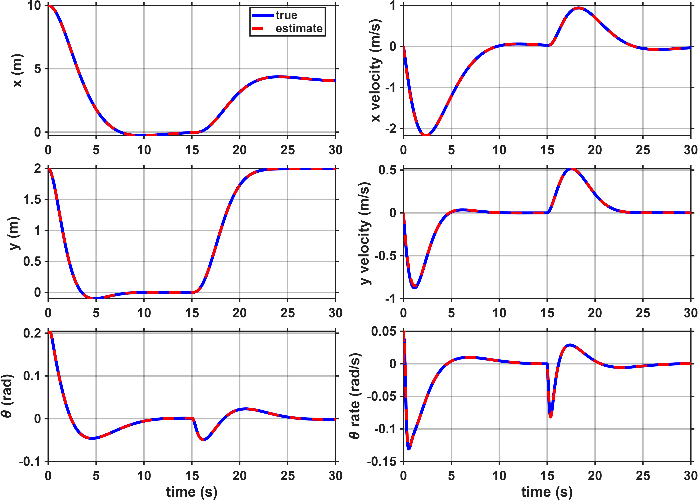
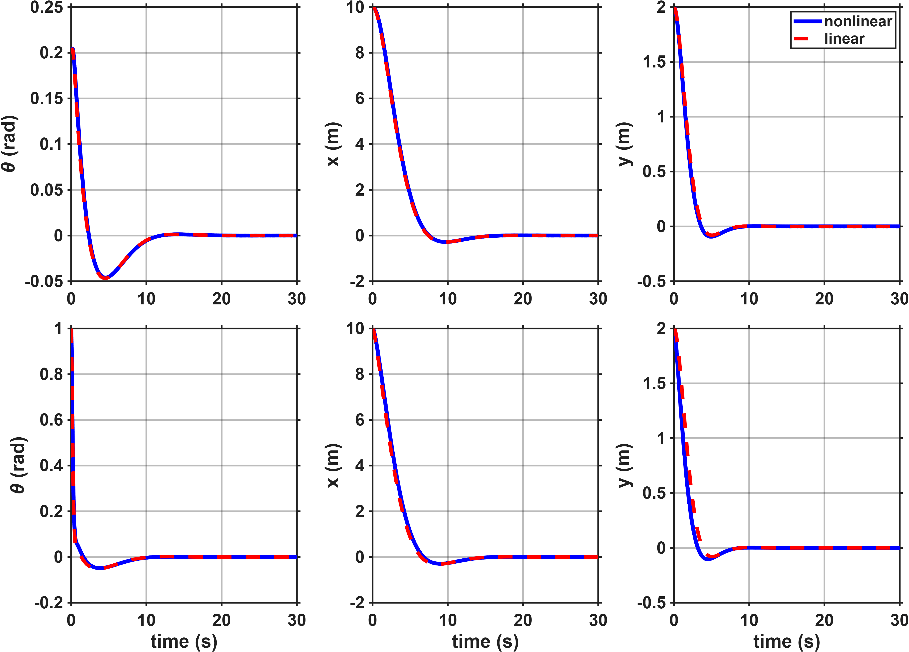
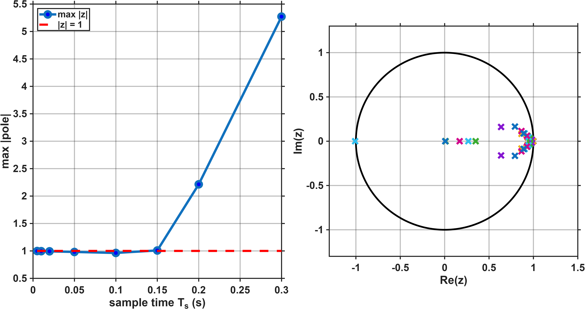

# EGH445 Modern Control: Vectored-Thrust VTOL (High Distinction)

**Discrete-time LQG control of a scaled planar vectored-thrust aircraft about hover.**

Individual project for EGH445 Modern Control (QUT), marked **39.1 / 40 (97.75%)**.
The repository holds the MATLAB code, the generated figures and the final [report](Report.pdf).



## The problem

A planar VTOL aircraft cannot accelerate sideways directly. To correct a horizontal position
error it has to tilt, redirect part of its thrust, and level out again, so position and pitch
are tightly coupled. Only position and pitch are measured, and the measurements come from a
noisy black-box simulator. The controller has to:

- recover from an initial offset of `(x, y, θ) = (10 m, 2 m, 0.2 rad)` to hover at the origin
- then track a step to a new hover point at `(4, 2)`
- keep pitch inside the region where the hover linearisation is valid (`|θ| < 0.35 rad`)
- stay within the actuator limits

## Design

| Step | What was done | File |
| --- | --- | --- |
| Model | Six-state nonlinear PVTOL model, `[x, ẋ, y, ẏ, θ, θ̇]`, with thrust shifted about the hover load `mg` | `VTOL_Dynamics_corrected.m` |
| Linearise and discretise | Jacobian linearisation at level hover, zero-order hold at `Ts = 0.01 s` | `design.m` |
| State feedback | Discrete LQR, with pitch weighted most heavily to protect the linearisation | `design.m` |
| State estimation | Steady-state Kalman observer in prediction form, reconstructing the three unmeasured velocities | `design.m` |
| Tracking | Set-point shifting through a critically damped second-order prefilter, sized so the implied tilt stays in the valid region | `my_controller.m`, `reference_signal.m` |
| Implementation | Observer-based LQR with hover-thrust feedforward, run once per sample | `my_controller.m` |

Physical parameters, the sample time and the initial condition are defined once in `SystemParameters.m`.

## Results

Nonlinear simulation with noisy output feedback, 30 s run:

| Metric | Result |
| --- | --- |
| Controllability and observability rank | 6 and 6 (full) |
| Largest regulator pole magnitude | 0.9963 |
| Largest observer pole magnitude | 0.9687 |
| Final position error | 0.0465 m |
| Maximum pitch | 0.2039 rad (11.7°), limit 0.35 rad |
| Maximum moment-channel effort | 0.23 N, no saturation |
| Largest observer RMS error | 0.0086 m/s, in the reconstructed x velocity |



The states recover to the origin, then follow the step to `(4, 2)` at 15 s. The thrust channel
stays close to the hover load throughout.



### How far the design can be trusted



- **Operating envelope:** recovery stays inside the valid pitch region for offsets up to about 15 m at small initial pitch. Larger offsets, or an initial pitch of 0.35 rad or more, may still recover but leave the region the linear model was validated for.
- **Sampling rate:** the loop is stable up to `Ts = 0.10 s` and unstable at `Ts = 0.15 s`, so the chosen 100 Hz is conservative.
- **Known limitation:** there is no integral action or reference feedforward gain, so a small steady-state offset remains for non-zero references. That is the 0.0465 m above.



## Running it

Requires MATLAB with the Control System Toolbox.

```matlab
cd Code
run_all     % designs the controller and observer, simulates, plots and animates
```

`run_all` chains the two stages, which can also be run separately:

| Script | Purpose |
| --- | --- |
| `design.m` | Linearise, discretise, compute the LQR and observer gains, save them to `designValues.mat` |
| `main.m` | Simulate the closed loop on the nonlinear plant and print the diagnostics |
| `make_figures.m` | Produce every figure in `PVTOL_Figures/` (called by `main.m`) |
| `Animate_VTOL.m` | Animate the flight (called by `main.m`) |
| `lqr_sensitivity.m` | Sweep the LQR input penalty `R` |
| `test1.m` | Sweep the reference prefilter bandwidth |
| `test2.m` | Sweep initial offset and pitch to map the operating envelope |

`System_Simulator.p` and `VTOL_Dynamics.p` are the black-box simulator files supplied by the unit.

## Repository layout

```text
Code/
├── run_all.m                    entry point
├── SystemParameters.m           physical and simulation constants
├── design.m                     controller and observer design
├── main.m                       simulation and diagnostics
├── my_controller.m              the controller the simulator calls each sample
├── reference_signal.m           commanded hover setpoint against time
├── VTOL_Dynamics_corrected.m    nonlinear plant model
├── make_figures.m               all plots
├── Animate_VTOL.m               animation
├── lqr_sensitivity.m, test1.m, test2.m    sensitivity studies
├── designValues.mat             saved gains and model matrices
└── PVTOL_Figures/               figures used in the report
Report.pdf                       final report
```

## Assessment

| Component | Mark | Class average |
| --- | ---: | ---: |
| Demo and questions | 15 / 15 | 10.8 / 15 |
| Code and functional system | 5 / 5 | 4.2 / 5 |
| Report | 19.1 / 20 | 14.6 / 20 |
| **Total** | **39.1 / 40 (97.75%)** | **29.6 / 40 (74%)** |

Class averages are the benchmarks released by the marking team.

## Author

**Chabod Masere**

🎓 Master of Robotics and Artificial Intelligence
<br>
🎓 Bachelor of Engineering, Electrical & Aerospace
